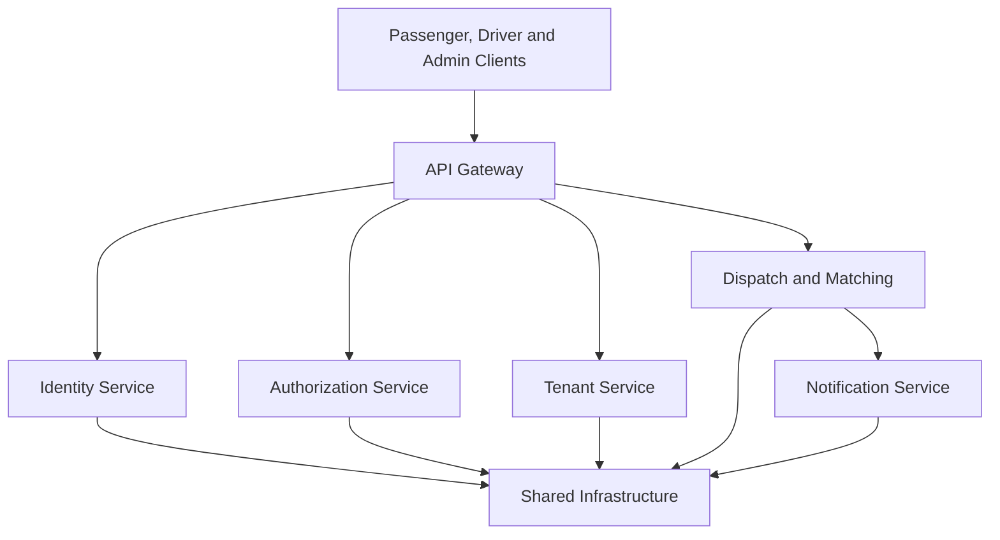
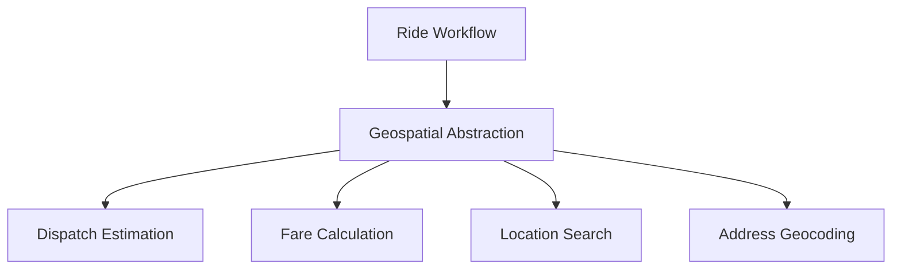

# Vite Ride Backend Platform

A sanitized architectural showcase of selected components from the backend I designed and implemented for **Vite Ride**, a multi-tenant ride-hailing platform initiated by Vite Technologies PLC.

The complete platform included passenger and driver mobile applications, an administrative dashboard and a distributed backend supporting identity, tenant management, ride requests, driver matching, trip progression, notifications, fare estimation and geospatial operations.

> **Confidentiality notice:** This repository contains only selected, non-sensitive backend components. Business rules, production configuration, internal algorithms, deployment infrastructure and other commercially sensitive implementation details have been intentionally excluded.

## Project Overview

Vite Ride was developed to support the core workflow of a modern ride-hailing service:

1. A passenger searches for pickup and destination locations.
2. The platform estimates the route, distance, travel time and fare.
3. The passenger submits a ride request.
4. The dispatch service searches for suitable available drivers.
5. A driver receives and accepts the request.
6. The ride progresses through its operational states.
7. Passenger, driver and administrative applications receive ride updates.
8. The completed trip becomes available for operational review.

The project also explored how open-source-compatible geospatial solutions could support routing, search, geocoding and fare-estimation requirements while reducing dependency on expensive proprietary providers.

## My Role: Project Manager and Sole Backend Developer

I served as the **project manager and sole backend developer** for Vite Ride during my internship at Vite Technologies PLC.

As project manager, I coordinated the development of the complete system across the backend, passenger application, driver application and administrative dashboard. My project-management responsibilities included:

- Supporting project planning and scope definition
- Breaking the system into manageable functional areas
- Coordinating responsibilities across the development team
- Monitoring implementation progress
- Supporting communication between backend, mobile and frontend work
- Coordinating system integration
- Identifying technical dependencies and integration blockers
- Organizing functional and scenario-based testing
- Participating in progress reviews with company leadership
- Supporting technical documentation
- Helping ensure that individual components formed one integrated platform

As the sole backend developer, I was responsible for the design and implementation of the backend platform. My backend responsibilities included:

- Designing the backend architecture and service boundaries
- Structuring the NestJS monorepo
- Implementing the API Gateway
- Implementing identity and authentication functionality
- Implementing authorization and access-control services
- Implementing tenant-management functionality
- Developing dispatch and driver-matching services
- Supporting ride-request and trip-progression workflows
- Designing service-to-service communication using gRPC
- Implementing event-driven communication
- Supporting real-time updates through WebSockets and Socket.IO
- Integrating Redis for real-time and transient operations
- Integrating MongoDB through Mongoose
- Creating reusable shared libraries and contracts
- Designing abstractions for routing, geocoding and location search
- Supporting notification integration
- Conducting backend integration and functional testing

The public repository contains only a sanitized portion of the backend I implemented.

## Repository Purpose


It demonstrates experience with:

- NestJS microservices
- TypeScript
- API Gateway architecture
- Multi-tenant backend design
- Identity and authentication
- Policy-based authorization
- gRPC communication
- CQRS
- Event-driven communication
- Dispatch and driver matching
- WebSocket communication
- Redis integration
- MongoDB persistence
- External-service abstraction
- Modular geospatial architecture

This repository is intended primarily for architecture and source-code review. It is not the complete commercial platform or an official production release.

## Public Repository Structure

```text
apps/
├── api-gateway/
├── authorization-service/
├── dispatch-matching-service/
├── identity-service/
├── notifications-service/
└── tenants-service/

libs/
└── Shared libraries, contracts and infrastructure
```

The complete internal backend contained additional functionality and configuration that cannot be shared publicly.

## High-Level Architecture



The architecture separates major operational responsibilities into independently organized NestJS services. Shared libraries provide reusable contracts and infrastructure across the monorepo.

## Backend Services

### API Gateway

The API Gateway provides the main entry point for passenger, driver and administrative applications.

Its responsibilities include:

- Receiving external requests
- Validating request data
- Forwarding operations to internal services
- Coordinating service responses
- Maintaining a consistent external API
- Preventing direct exposure of internal services

### Identity Service

The Identity Service manages user identity and authentication.

Its responsibilities include:

- User registration
- Credential validation
- Secure password handling
- Authentication-token generation
- Account-status management
- Identity retrieval
- Separation of authentication from other business domains

### Authorization Service

The Authorization Service determines whether authenticated users are permitted to perform requested operations.

It supports:

- Role-based authorization
- Policy-based authorization
- Resource-access decisions
- Tenant-aware access policies
- Centralized permission evaluation
- Separation of authentication from authorization

Casbin is used to support structured access-control policies.

### Tenant Service

The Tenant Service supports multiple ride operators through one shared platform.

Its responsibilities include:

- Tenant registration and management
- Tenant administrative context
- Tenant-aware request processing
- Organization-specific configuration
- Association of users and operations with tenants
- Support for tenant-level access control

The public repository demonstrates the tenant-aware architectural direction without exposing complete production isolation mechanisms.

### Dispatch and Matching Service

The Dispatch and Matching Service coordinates driver selection for ride requests.

Its responsibilities include:

- Receiving dispatch requirements
- Identifying available driver candidates
- Supporting proximity-based evaluation
- Coordinating driver matching
- Managing dispatch-related state
- Returning matching results to the ride workflow

Detailed matching rules, driver-ranking algorithms and production configuration are not publicly disclosed.

### Notification Service

The Notification Service separates user communication from the main ride workflow.

It supports:

- Ride-request notifications
- Driver-assignment notifications
- Ride-status updates
- Push-notification integration
- Real-time client communication
- Event-driven application notifications

### Shared Libraries

Shared libraries reduce duplication and maintain consistent behavior across services.

They include reusable elements such as:

- Data Transfer Objects
- TypeScript interfaces
- gRPC contracts
- Validation schemas
- Authentication utilities
- Request-context utilities
- Domain results
- Error definitions
- Constants
- Mappers
- Infrastructure abstractions

## Communication Model

The backend uses different communication mechanisms according to operational requirements.

### External Communication

Passenger, driver and administrative applications communicate through the API Gateway.

### gRPC Communication

gRPC supports structured internal communication when one service requires an immediate response from another service.

### Event-Driven Communication

Application events allow services to respond to state changes without creating unnecessary direct dependencies.

### Real-Time Communication

WebSockets and Socket.IO support time-sensitive updates for ride and notification workflows.

### Redis

Redis supports transient backend operations and real-time infrastructure, including Socket.IO scaling through the Redis adapter.

## Geospatial Architecture

Ride-hailing platforms depend on several geospatial functions, but those functions do not all have the same requirements.

The backend treats them as separate capabilities behind provider-independent abstractions.



### Dispatch Estimation

Driver matching requires responsive distance and ETA estimates because several driver candidates may need to be evaluated quickly.

### Fare Calculation

Fare calculation requires consistent route distance because the result affects billing accuracy and user trust.

### Location Search

Location search and autocomplete prioritize responsiveness and relevant suggestions during pickup and destination selection.

### Address Geocoding

Geocoding converts human-readable locations into coordinates that can be used by routing services.

### Provider Abstraction

Geospatial providers are placed behind abstractions rather than being embedded directly in ride and dispatch business logic.

This design supports:

- Independent provider evaluation
- Replacement of external providers
- Future self-hosting
- Reduced vendor lock-in
- Different tools for different geospatial responsibilities
- Cost-conscious infrastructure decisions
- Easier maintenance and testing

Specific provider configuration and internal selection logic are excluded for confidentiality.

## Multi-Tenant Design

Vite Ride was designed to support multiple operating organizations through a shared backend.

Tenant-aware processing includes:

- Identifying the tenant associated with each request
- Maintaining tenant context across services
- Applying tenant-aware access policies
- Associating users and operations with organizations
- Supporting tenant-specific administration
- Preventing unauthorized cross-tenant access
- Separating shared platform behavior from tenant configuration

Multi-tenancy is treated as a backend concern rather than only a user-interface feature.

## Security Architecture

The backend incorporates security-related technologies and patterns including:

- JWT authentication
- Passport authentication strategies
- bcrypt password hashing
- Role-based authorization
- Policy-based authorization
- Casbin policy management
- DTO validation
- Zod schemas
- Tenant-aware permission checks
- Request-context management
- Environment-based configuration
- Centralized error handling
- Controlled service boundaries

Production secrets, authentication keys, policies and environment configuration are not included.

## Technology Stack

| Category | Technology |
|---|---|
| Language | TypeScript |
| Backend framework | NestJS |
| Repository structure | Modular monorepo |
| Architecture | Microservices |
| API boundary | API Gateway |
| Service communication | gRPC |
| Application patterns | CQRS and event-driven communication |
| Database | MongoDB |
| Database integration | Mongoose |
| Authentication | JWT and Passport |
| Password security | bcrypt |
| Authorization | Casbin |
| Real-time infrastructure | Redis and ioredis |
| Real-time communication | Socket.IO and WebSockets |
| Push notifications | Firebase Admin |
| HTTP integration | Axios |
| Validation | class-validator and Zod |
| Testing | Jest and Supertest |
| Code quality | ESLint and Prettier |

## Engineering Principles

### Separation of Concerns

Identity, authorization, tenant management, dispatch and notifications are separated into focused services.

### Loose Coupling

gRPC contracts, events and infrastructure abstractions reduce unnecessary direct dependencies.

### Replaceable Infrastructure

External integrations are placed behind abstractions so implementations can change without rewriting core business logic.

### Reusable Contracts

Shared libraries provide consistent contracts and reusable components across services.

### Scalability

Service separation allows independently demanding components to be scaled separately when supported by suitable infrastructure.

### Maintainability

Clear service boundaries, dependency injection, validation and shared abstractions support long-term development.

## Development and Evaluation

The project was developed through an incremental and iterative process.

Development activities included:

- Requirements analysis
- Backend architecture design
- Service-boundary definition
- Incremental implementation
- Cross-component integration
- Functional testing
- Scenario-based ride testing
- Administrative workflow testing
- Passenger and driver workflow testing
- Ride-state synchronization testing
- Geospatial feasibility evaluation
- Dispatch and fare-estimation evaluation

The platform was evaluated under controlled, non-production conditions. The evaluation demonstrated functional feasibility but did not represent production-scale performance benchmarking.

## Repository Setup

Clone the sanitized backend sample:

```bash
git clone https://github.com/Sye-1321/vite-ride-platform.git
cd vite-ride-platform
npm install
```

Start individual services:

```bash
# API Gateway
npm run start:dev:api-gateway

# Identity Service
npm run start:dev:identity

# Authorization Service
npm run start:dev:authorization

# Tenant Service
npm run start:dev:tenants

# Notification Service
npm run start:dev:notifications
```

Start the services configured by the combined development command:

```bash
npm run dev:all
```

Run code-quality checks:

```bash
npm run lint
npm run format:check
```

Run configured tests:

```bash
npm run test
npm run test:e2e
npm run test:coverage
```

> Some services, contracts, environment variables and infrastructure dependencies required by the complete platform are intentionally unavailable. Therefore, this public repository may not reproduce the full system independently.

## Public Repository Limitations

The public repository does not include the complete:

- Production backend
- Passenger mobile application
- Driver mobile application
- Administrative dashboard
- Internal company documentation
- Business rules
- Driver-ranking algorithms
- Fare policies
- Production geospatial configuration
- Deployment infrastructure
- CI/CD configuration
- Monitoring infrastructure
- Production data
- Credentials or secret keys
- Commercial roadmap

The repository:

- Is not an official company release
- Is not intended for production deployment
- Does not demonstrate production-scale performance
- Does not expose confidential algorithms or business rules
- Does not represent the company’s current product status or future plans

## Professional Context

Vite Ride was developed as an internally initiated project at Vite Technologies PLC.

Working as the project manager and sole backend developer provided practical experience in:

- Technical project coordination
- Backend ownership
- Microservice architecture
- Multi-tenant system design
- Service integration
- Real-time communication
- Geospatial problem decomposition
- Cost-conscious engineering
- Cross-functional coordination
- Development under confidentiality requirements

## Ownership and Disclaimer

Vite Ride is an initiative of Vite Technologies PLC. The project name, company materials, internal documentation, commercial concepts and non-public implementation remain the property of their respective owner.


The repository author claims responsibility only for the work personally performed and does not claim ownership of confidential company materials that are not included.