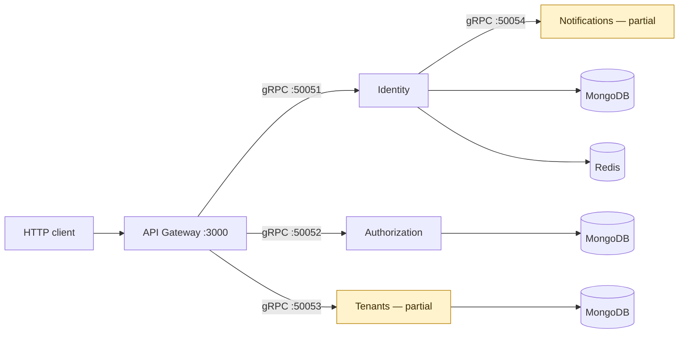

# Vite Ride Backend Architecture — Sanitized Public Edition

[](https://github.com/Sye-1321/vite-ride-backend-architecture/actions/workflows/core-services.yml)

> A sanitized, selectively published edition derived from the Vite Ride
> backend I designed and implemented as the sole backend developer at Vite
> Technologies.

Vite Ride is a ride-hailing platform whose private backend was organized across
eight microservices. This repository presents the portion of that architecture
that can be shared safely: a runnable NestJS monorepo centered on the API
Gateway, Identity, Authorization, Tenants, Notifications, and selected shared
libraries.

This is not a mock ride-hailing project and it is not the complete private
backend. It is a confidentiality-safe engineering case study and portfolio
artifact derived from real development work, with later public-only
reorganization, hardening, testing, dependency maintenance, and documentation.

## What this repository represents

The public edition demonstrates how the retained services collaborate without
publishing confidential ride operations, pricing rules, payment integrations,
production infrastructure, credentials, customer data, or internal operating
procedures.

Every retained service was reviewed and adapted for the public disclosure
boundary. “Included” therefore does not mean that the complete private
implementation of that service has been published. Tenants and Notifications
are intentionally partial representations of their original service domains.

## My role

I served as the sole backend developer for Vite Ride at Vite Technologies. My
work covered backend architecture, service boundaries, domain modeling,
internal contracts, authentication and authorization, persistence foundations,
realtime infrastructure, notification integration, and automated verification.

The source and design records published here demonstrate a safe portion of that
work. They do not disclose the complete private product.

## Project provenance

The private Vite Ride backend was completed before this public repository was
prepared. Subsequent work in this repository applies to the sanitized public
edition: architectural reorganization, dependency updates, security hardening,
automated tests, documentation, and local runtime support.

These later improvements should not be interpreted as ongoing development of
the original private product unless explicitly stated. The public edition is
maintained as an independent technical artifact derived from the completed
backend.

## Original system context

| Original backend service      | Public representation                                |
| ----------------------------- | ---------------------------------------------------- |
| API Gateway                   | Sanitized implementation included                    |
| Identity Service              | Sanitized implementation included                    |
| Authorization Service         | Sanitized implementation included                    |
| Tenants Service               | Partial sanitized implementation                     |
| Notifications Service         | Partial implementation with confidentiality-safe I/O |
| Dispatch and Matching Service | Intentionally excluded                               |
| Trip Management Service       | Intentionally excluded                               |
| Payment and Fare Service      | Intentionally excluded                               |

The excluded services are represented here only as architectural context. No
empty service shells or invented implementations are included to imply public
coverage that does not exist.

## Public architecture



The Gateway is the only public HTTP process. Internal service calls use gRPC.
Identity, Authorization, and Tenants use MongoDB; Identity also uses Redis.
Notifications defaults to dry-run SMS and push adapters so local verification
does not contact external providers.

## Engineering capabilities demonstrated

- Explicit HTTP and gRPC service boundaries in a NestJS monorepo.
- Fail-closed authentication and tenant-scoped authorization.
- Mongo-backed identity, authorization, tenant, membership, and driver models.
- CQRS-oriented tenant workflows with transactional persistence boundaries.
- Transactional outbox delivery for cross-service role synchronization.
- Request-context propagation and redacted structured logging.
- Authenticated, tenant-scoped Socket.IO infrastructure with Redis fan-out.
- Provider-isolated notification delivery with timeout and payload validation.
- Health and readiness checks for service dependencies.
- Unit, integration, boundary, contract, and end-to-end verification.
- Reproducible Node.js 22, Docker Compose, and CI runtime baselines.

## Verified service flows

- Identity creates hashed verification sessions and requests delivery through
  Notifications.
- Notifications validates SMS and push commands and supports redacted dry-run
  delivery.
- Authorization assigns and removes domain-scoped roles and evaluates Casbin
  policies.
- Tenants manages the published portion of tenant lifecycle, memberships, and
  tenant-scoped driver profiles.
- Tenant membership mutations publish authorization synchronization work
  through a transactional outbox.
- The Gateway validates HTTP input, propagates request context, and performs
  remote permission checks before protected operations.

## Applications

| Application   | Transport | Default           | Documentation                                 |
| ------------- | --------- | ----------------- | --------------------------------------------- |
| API Gateway   | HTTP      | `:3000/vite-ride` | [Guide](apps/api-gateway/README.md)           |
| Identity      | gRPC      | `:50051`          | [Guide](apps/identity-service/README.md)      |
| Authorization | gRPC      | `:50052`          | [Guide](apps/authorization-service/README.md) |
| Tenants       | gRPC      | `:50053`          | [Guide](apps/tenants-service/README.md)       |
| Notifications | gRPC      | `:50054`          | [Guide](apps/notifications-service/README.md) |

## Shared libraries

| Library                                             | Purpose                                                |
| --------------------------------------------------- | ------------------------------------------------------ |
| [Adapters](libs/adapters/README.md)                 | Hashing, token, OTP, and logging adapters              |
| [Application Core](libs/application-core/README.md) | Shared application errors, guards, and decorators      |
| [Audit](libs/audit/README.md)                       | Audit value objects, factories, and mapping            |
| [Auth](libs/auth/README.md)                         | JWT contracts, token adapter, and strategies           |
| [Common](libs/common/README.md)                     | Errors, filters, guards, validation, and API utilities |
| [Context](libs/context/README.md)                   | HTTP and gRPC request-context propagation              |
| [Persistence](libs/persistence/README.md)           | Mongo connection and repository foundations            |
| [Proto Schema](libs/proto-schema/README.md)         | Internal gRPC contracts                                |
| [Realtime](libs/realtime/README.md)                 | Authenticated Socket.IO and Redis fan-out              |
| [Redis](libs/redis/README.md)                       | Redis connectivity                                     |
| [Redis Store](libs/redis-store/README.md)           | Redis key-value repository foundations                 |
| [Routing](libs/routing/README.md)                   | Geocoding and route-metric abstraction                 |
| [Shared Kernel](libs/shared-kernel/README.md)       | Domain primitives, ports, and injection tokens         |

Routing and Realtime remain reusable libraries rather than complete public
ride-operation applications.

## Engineering process

Two design records explain the reasoning that preceded and informed the
backend architecture:

- [Ride-Hailing Systems Architecture Review](docs/architecture/ride-hailing-systems-review.md)
  documents the evaluation framework, recurring correctness failures, and the
  adopt/adapt/avoid decisions taken from comparative repository research.
- [Vite Ride Resilient Backend System Design](docs/architecture/vite-ride-resilient-system-design.md)
  records the low-connectivity design investigation, intended service
  boundaries, and conceptual requirements.

The second document is a design record, not an implementation-coverage claim.
It includes explored capabilities that are not present in this public edition
and were not necessarily implemented in the completed private backend.

## Prerequisites

- Node.js 22
- npm
- Docker with Compose, or locally installed MongoDB and Redis

Install exact dependencies:

```bash
npm ci
```

## Local configuration

Copy the placeholder configuration:

```bash
cp .env.example .env
```

Replace both JWT placeholder secrets before starting Identity or the Gateway.
The sample database and Redis addresses refer only to local services.

Start the infrastructure:

```bash
docker compose up -d
```

MongoDB and Redis must be healthy before their dependent services start.

## Start the public service set

Start processes individually in dependency order:

```bash
npm run start:dev:notifications
npm run start:dev:authorization
npm run start:dev:tenants
npm run start:dev:identity
npm run start:dev:api-gateway
```

Or start all five watch processes:

```bash
npm run start:dev:core
```

The default API base is `http://127.0.0.1:3000/vite-ride`.

## Configuration reference

| Variable                      | Default or local value | Owner         |
| ----------------------------- | ---------------------- | ------------- |
| `GATEWAY_PORT`                | `3000`                 | Gateway       |
| `GATEWAY_PREFIX`              | `vite-ride`            | Gateway       |
| `IDENTITY_GRPC_BIND_URL`      | `0.0.0.0:50051`        | Identity      |
| `IDENTITY_GRPC_URL`           | `127.0.0.1:50051`      | Gateway       |
| `AUTHORIZATION_GRPC_BIND_URL` | `0.0.0.0:50052`        | Authorization |
| `AUTHORIZATION_GRPC_URL`      | `127.0.0.1:50052`      | Gateway       |
| `TENANTS_GRPC_BIND_URL`       | `0.0.0.0:50053`        | Tenants       |
| `TENANTS_GRPC_URL`            | `127.0.0.1:50053`      | Gateway       |
| `NOTIFICATIONS_GRPC_BIND_URL` | `0.0.0.0:50054`        | Notifications |
| `NOTIFICATIONS_GRPC_URL`      | `127.0.0.1:50054`      | Identity      |
| `DATABASE_URL_IDENTITY`       | Local Mongo URI        | Identity      |
| `DATABASE_URL_AUTHZ`          | Local Mongo URI        | Authorization |
| `DATABASE_NAME_AUTHZ`         | `vite_ride_authz`      | Authorization |
| `DATABASE_URL_TENANTS`        | Local Mongo URI        | Tenants       |
| `REDIS_URL`                   | Local Redis URI        | Identity      |
| `SMS_DRIVER`                  | `dry-run`              | Notifications |
| `PUSH_DRIVER`                 | `dry-run`              | Notifications |

JWT configuration is documented in the Identity and Gateway guides. External
provider credentials are required only when live notification drivers are
selected.

## Verification

Build all published applications:

```bash
npm run build:core
```

Run unit, integration, and Gateway boundary tests:

```bash
npm run test:core
```

Run the complete local quality gate:

```bash
npm run check:core
```

The complete gate runs ESLint, Prettier verification, all five builds, and the
focused test suites. External notification providers are not contacted.

## Security properties

- Secrets and provider credentials are supplied through the environment and
  are not printed.
- Verification codes, message bodies, phone numbers, device tokens,
  authentication payloads, and provider responses are excluded from logs.
- Protected tenant routes authenticate first and fail closed on authorization
  denial or upstream failure.
- Tenant roles are scoped by `<tenantId>::<userId>` in the policy engine.
- Internal service operations use gRPC rather than public HTTP routes.

These controls describe the verified public boundary. They do not independently
establish production readiness for a deployment.

## Public scope boundaries

- Dispatch, trip lifecycle, matching, pricing, payment, and reconciliation
  implementations are not published.
- Tenants and Notifications expose only the portions selected for this public
  edition.
- Dry-run notification adapters demonstrate orchestration without disclosing or
  contacting live providers.
- Routing and Realtime are retained as reusable infrastructure without complete
  public ride-operation flows.
- Production topology, scale results, disaster-recovery procedures, monitoring
  systems, and deployment configuration are outside this repository.
- Passing the included checks verifies this source tree; it is not a claim that
  the public subset is the complete production system.

## Ownership and use

The Vite Ride name and non-public product materials remain the property of Vite
Technologies and other applicable rights holders. This repository contains only
the selectively published technical boundary described above. Its publication
does not grant rights to omitted proprietary code, data, infrastructure, or
business rules.
