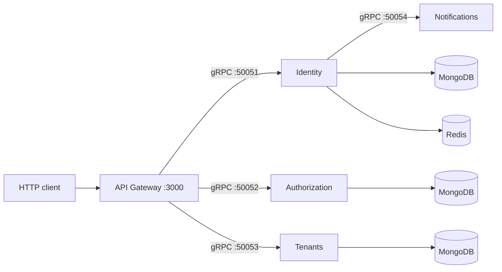

# Vite Ride — Sanitized Core Services

This repository is a sanitized version of the Vite Ride backend architecture.
It presents a confidentiality-safe NestJS service subset centered on identity,
authorization, tenant management, and internal notifications. The code is
structured as a TypeScript monorepo with one public HTTP boundary and four
internal gRPC services.

No production credentials, customer data, private infrastructure addresses, or
non-public operational rules belong in this repository.

## Architecture



The Gateway is the only public HTTP process. Notifications is internal-only.
Identity, Authorization, and Tenants require MongoDB. Identity also requires
Redis. Notifications uses dry-run SMS and push adapters by default.

## Applications

| Application   | Transport | Default           | Documentation                                 |
| ------------- | --------- | ----------------- | --------------------------------------------- |
| API Gateway   | HTTP      | `:3000/vite-ride` | [Guide](apps/api-gateway/README.md)           |
| Identity      | gRPC      | `:50051`          | [Guide](apps/identity-service/README.md)      |
| Authorization | gRPC      | `:50052`          | [Guide](apps/authorization-service/README.md) |
| Tenants       | gRPC      | `:50053`          | [Guide](apps/tenants-service/README.md)       |
| Notifications | gRPC      | `:50054`          | [Guide](apps/notifications-service/README.md) |

### Verified service flows

- Identity creates hashed verification sessions and sends verification codes
  through Notifications.
- Notifications validates SMS and push requests and supports redacted dry-run
  delivery.
- Authorization assigns and removes domain-scoped roles and evaluates Casbin
  policies.
- Tenants manages tenant lifecycle, memberships, and tenant-scoped driver
  profiles.
- The Gateway validates HTTP input, propagates request context, and applies
  remote tenant permission checks before protected operations.

## Libraries

Every retained library has its own technical boundary guide.

| Library                                             | Purpose                                                |
| --------------------------------------------------- | ------------------------------------------------------ |
| [Adapters](libs/adapters/README.md)                 | Hashing, token, OTP, and logging adapters              |
| [Application Core](libs/application-core/README.md) | Application decorator and guard scaffolding            |
| [Audit](libs/audit/README.md)                       | Audit value objects, factories, and mapping            |
| [Auth](libs/auth/README.md)                         | JWT contracts, token adapter, and strategies           |
| [Common](libs/common/README.md)                     | Errors, filters, guards, validation, and API utilities |
| [Context](libs/context/README.md)                   | HTTP and gRPC request-context propagation              |
| [Persistence](libs/persistence/README.md)           | Mongo connection and repository foundations            |
| [Proto Schema](libs/proto-schema/README.md)         | Internal gRPC contracts                                |
| [Realtime](libs/realtime/README.md)                 | Authenticated Socket.IO and Redis fan-out adapter      |
| [Redis](libs/redis/README.md)                       | Redis connectivity                                     |
| [Redis Store](libs/redis-store/README.md)           | Redis key-value repository bases                       |
| [Routing](libs/routing/README.md)                   | Geocoding and route-metric abstraction                 |
| [Shared Kernel](libs/shared-kernel/README.md)       | Domain primitives, ports, and injection tokens         |

Routing and Realtime are reusable libraries; they are not active applications
in the runnable core flow.

## Prerequisites

- Node.js 22
- npm
- Docker with Compose, or locally installed MongoDB and Redis

Install exact dependencies:

```bash
npm ci
```

## Local configuration

Copy the placeholder template:

```bash
cp .env.example .env
```

Replace both JWT placeholder secrets before starting Identity or the Gateway.
The sample database and Redis addresses refer only to the local Compose
services.

Start local infrastructure:

```bash
docker compose up -d
```

MongoDB and Redis must be healthy before the dependent services start.

## Start the core

Start processes in this order so upstream dependencies are available:

```bash
npm run start:dev:notifications
npm run start:dev:authorization
npm run start:dev:tenants
npm run start:dev:identity
npm run start:dev:api-gateway
```

Or start all five watch processes:

```bash
npm run start:dev:core
```

The default API base is `http://127.0.0.1:3000/vite-ride`.

## Configuration reference

| Variable                      | Default or local value | Owner         |
| ----------------------------- | ---------------------- | ------------- |
| `GATEWAY_PORT`                | `3000`                 | Gateway       |
| `GATEWAY_PREFIX`              | `vite-ride`            | Gateway       |
| `IDENTITY_GRPC_BIND_URL`      | `0.0.0.0:50051`        | Identity      |
| `IDENTITY_GRPC_URL`           | `127.0.0.1:50051`      | Gateway       |
| `AUTHORIZATION_GRPC_BIND_URL` | `0.0.0.0:50052`        | Authorization |
| `AUTHORIZATION_GRPC_URL`      | `127.0.0.1:50052`      | Gateway       |
| `TENANTS_GRPC_BIND_URL`       | `0.0.0.0:50053`        | Tenants       |
| `TENANTS_GRPC_URL`            | `127.0.0.1:50053`      | Gateway       |
| `NOTIFICATIONS_GRPC_BIND_URL` | `0.0.0.0:50054`        | Notifications |
| `NOTIFICATIONS_GRPC_URL`      | `127.0.0.1:50054`      | Identity      |
| `DATABASE_URL_IDENTITY`       | Local Mongo URI        | Identity      |
| `DATABASE_URL_AUTHZ`          | Local Mongo URI        | Authorization |
| `DATABASE_NAME_AUTHZ`         | `vite_ride_authz`      | Authorization |
| `DATABASE_URL_TENANTS`        | Local Mongo URI        | Tenants       |
| `REDIS_URL`                   | Local Redis URI        | Identity      |
| `SMS_DRIVER`                  | `dry-run`              | Notifications |
| `PUSH_DRIVER`                 | `dry-run`              | Notifications |

JWT secrets and expiration settings are documented in the
[Identity](apps/identity-service/README.md) and
[Gateway](apps/api-gateway/README.md) guides. External notification credentials
are required only when their live drivers are selected.

## Verification

Build all supported applications:

```bash
npm run build:core
```

Run unit, integration, and Gateway boundary tests:

```bash
npm run test:core
```

Run the full local quality gate:

```bash
npm run check:core
```

The full gate runs ESLint, Prettier verification, all five builds, and the
focused test suites. External notification providers are not contacted.

## Security properties

- JWT secrets and provider credentials are required through the runtime
  environment and are never printed.
- Verification codes, message bodies, phone numbers, device tokens,
  authentication payloads, and provider responses are excluded from logs.
- Tenant-specific Gateway routes authenticate first and then fail closed on an
  Authorization denial or upstream error.
- Tenant roles are scoped by `<tenantId>::<userId>` in the policy engine.
- Internal services are exposed through gRPC rather than public HTTP routes.

These controls establish the verified repository boundary; they do not by
themselves establish production readiness.

## Known limitations

- Identity, Authorization, and Tenants require MongoDB; Identity also requires
  Redis.
- Dry-run Notifications proves internal orchestration, not external delivery.
- Tenant creation writes the tenant before assigning its Authorization role;
  this cross-service sequence is not a distributed transaction.
- Routing and Realtime are retained libraries without end-to-end application
  flows in this repository.
- The automated Gateway boundary test uses controlled service clients. A live
  five-process MongoDB/Redis smoke test still requires a running Docker daemon
  or equivalent local infrastructure.
- Passing the included checks does not establish production scale,
  observability, disaster recovery, or deployment readiness.

## Ownership

The repository name and applicable organizational materials remain the property
of their respective owners. This codebase contains only the supported,
non-sensitive service boundary described above.
