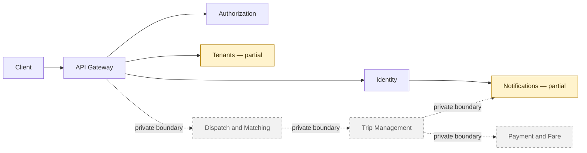

# Vite Ride Resilient Backend System Design

> **Document type:** Concept specification and architecture decision record
>
> **Design context:** Ride-hailing in low-connectivity environments, with
> Ethiopia and Tigray as the primary research context
>
> **Implementation status:** Mixed — this record contains implemented system
> context, design intentions, and explored capabilities
>
> **Public coverage:** The sanitized repository publishes only the boundary
> described in its root README

## 1. Purpose and interpretation

This document records the architectural investigation that informed Vite Ride.
It captures the operating constraints, intended service boundaries, resilience
model, and functional requirements considered during backend design.

It is not an as-built inventory and should not be used to infer implementation
coverage. Some capabilities describe the completed private system context;
others, including parts of the low-connectivity fallback model, represent
conceptual or proposed work. The sanitized public edition contains only the
services and behavior explicitly identified in the root README.

## 2. Design problem

Conventional ride-hailing applications assume continuous IP connectivity,
frequent GPS updates, and reliable access to mapping and payment APIs. Those
assumptions are unsafe in operating environments where mobile data can be slow,
intermittent, expensive, or temporarily unavailable.

The design therefore investigated a system in which network degradation became
a controlled operating mode instead of an immediate service-ending event. The
main concerns were:

- Receiving ride requests through more than one channel
- Preserving lifecycle correctness during delayed or duplicated communication
- Maintaining useful driver visibility when GPS updates become infrequent
- Separating realtime responsiveness from durable truth
- Producing auditable final fares despite noisy location data
- Supporting cash-heavy operations and local digital payment providers
- Controlling mapping costs through replaceable or self-hosted infrastructure
- Recovering buffered transactions after connectivity returns

## 3. Architectural principles

### 3.1 Centralize authoritative processing

Low-bandwidth channels should transport requests and status; they should not
perform dispatch, routing, pricing, or lifecycle decisions. All authoritative
processing belongs in the centrally managed backend.

### 3.2 Design for degraded modes

The platform should define explicit high-connectivity and low-connectivity
behavior rather than relying on repeated timeouts. Degradation changes payload
size, update frequency, confirmation latency, and delivery channel while
preserving the same business authority.

### 3.3 Prefer availability for transient geospatial data

Driver-location streams can tolerate temporary staleness when their source and
timestamp remain visible. Financial ledgers and committed lifecycle transitions
require stronger consistency.

### 3.4 Keep realtime delivery separate from correctness

WebSockets, push notifications, and SMS improve responsiveness. Persistence and
validated commands remain the source of truth. Losing a delivery event must not
invalidate a committed operation.

### 3.5 Make external systems replaceable

Routing, geocoding, messaging, identity providers, and payments belong behind
explicit ports. Infrastructure adapters can then change without moving vendor
logic into the domain.

## 4. Original backend service context

The completed private backend was organized around the following eight service
directories. The public edition exposes only the sanitized status shown here.

| Service                       | Architectural responsibility                                              | Public edition                    |
| ----------------------------- | ------------------------------------------------------------------------- | --------------------------------- |
| API Gateway                   | Public boundary, authentication, validation, routing, and request context | Sanitized implementation included |
| Identity Service              | User identity, credentials, verification, and token workflows             | Sanitized implementation included |
| Authorization Service         | Roles, permissions, and policy decisions                                  | Sanitized implementation included |
| Tenants Service               | Tenant, membership, and tenant-scoped profile workflows                   | Partial sanitized implementation  |
| Notifications Service         | Push, SMS, and notification-delivery orchestration                        | Partial sanitized implementation  |
| Dispatch and Matching Service | Driver location, reservation, assignment, routing, and ETA                | Excluded                          |
| Trip Management Service       | Ride request and committed trip lifecycle                                 | Excluded                          |
| Payment and Fare Service      | Fare calculation, payment handling, wallet, and reconciliation            | Excluded                          |

The public source must not be interpreted as a complete copy of any retained
private service. Sanitization and later public-only engineering changed the
published boundary.

## 5. Public architecture relationship



Dashed services provide system context only. Their implementations are not
present in the public repository.

## 6. Low-connectivity capability explored in design

The original design research proposed a Low-Tech Fallback Service (LTFS) as a
separate integration boundary for mobile-network channels. LTFS does not appear
in the completed eight-service directory inventory shown above and should be
treated as an explored capability rather than an implementation claim.

The proposed boundary contained two distinct responsibilities:

- A stateful USSD session handler for menu-driven rider interactions
- A stateless SMS gateway adapter for compressed driver updates and critical
  notifications

LTFS would translate provider-specific messages into standard internal
commands. Dispatch, route calculation, fare estimation, and trip-state changes
would remain in the core backend.

## 7. Hybrid connectivity model

### 7.1 Mode 1: IP and GPS

The default mode uses authenticated IP communication with frequent GPS updates.
It provides the freshest location, supports realtime UI updates, and enables
the shortest matching-feedback loop.

### 7.2 Mode 2: compressed SMS

When data connectivity degrades, the driver client could reduce update
frequency and encode only essential fields such as device identity, latitude,
longitude, source time, and sequence information.

The receiving adapter would validate, deduplicate, normalize, and publish the
payload as a standard location event. The dispatch domain would remain aware
that SMS-derived location has lower freshness and confidence than an IP update.

### 7.3 Mode 3: USSD status commands

If only basic voice or USSD service remained, manual commands could communicate
critical availability or trip-status intent. These commands would still pass
through authentication, validation, idempotency, and lifecycle enforcement in
the backend.

### 7.4 Connectivity transitions

A hybrid connectivity manager was expected to observe latency, packet loss,
bandwidth, and repeated failures. Switching channels should be explicit and
observable so the backend can distinguish fresh high-confidence data from
delayed fallback messages.

## 8. Ride request and lifecycle design

### 8.1 Separate intent from commitment

The design distinguishes a ride request from a ride:

- `RideRequest` represents a rider's intent before assignment.
- `Ride` represents a controlled commitment after a driver reservation is
  accepted.

This separation supports expiry, cancellation, rematching, and auditing without
forcing every request into the committed lifecycle.

### 8.2 Centralize the state machine

The ride aggregate should own legal transitions. Controllers and transport
handlers may request a transition but should not assign lifecycle status
directly.

Representative states include:

```text
requested -> matching -> driver_reserved -> accepted
accepted  -> driver_arrived -> in_progress -> completed
requested | matching | driver_reserved | accepted -> cancelled
```

The exact transition map and cancellation rules are private implementation
details and are not published here.

### 8.3 Define concurrency outcomes

The design must answer two critical races:

1. Two drivers attempt to accept the same request.
2. A cancellation arrives while acceptance is being processed.

Conditional persistence, aggregate versioning, or an equivalent atomic compare
and update should establish one winner. Commands require idempotency keys or
stable operation identifiers so client retries do not duplicate effects.

## 9. Dispatch and matching model

Matching is treated as resource allocation rather than a read-only nearest
driver query.

A matching attempt should:

1. Select eligible drivers using location, freshness, vehicle, tenant, and
   policy constraints.
2. Score candidates through an explicit strategy.
3. Atomically reserve one driver for a bounded period.
4. Notify the driver without treating delivery as acceptance.
5. Convert the reservation into commitment only after a valid response.
6. Release or expire the reservation after timeout, rejection, or cancellation.

Location-source confidence can influence scoring. An older SMS-derived position
may remain usable, but it should not be treated as equivalent to a recent GPS
update.

## 10. Routing and map matching

The design separated realtime and retrospective geospatial needs.

### 10.1 Realtime map matching

Realtime Map Matching (RTMM) uses only information available at the current
moment. It prioritizes latency for driver assignment, pickup ETA, and live
tracking. Temporary inaccuracy is acceptable if freshness and confidence remain
visible.

### 10.2 End-of-ride map matching

End-of-Ride Map Matching (EORMM) can use the complete trip history to clean the
route and determine an auditable distance. This was investigated as the basis
for final fare verification and dispute handling.

### 10.3 Routing infrastructure

Routing and geocoding should be accessed through domain ports. The design
considered OpenStreetMap-based engines such as Valhalla, GraphHopper, OSRM, and
Nominatim to control vendor cost and permit self-hosting where operationally
appropriate.

## 11. Data and messaging strategy

### 11.1 Persistence by consistency need

Different data classes require different guarantees:

- Identity, authorization, tenant, trip, and financial records require durable
  transactional persistence.
- High-volume driver location is optimized for write throughput, recency, and
  geospatial queries.
- Cached session and verification data may use Redis with explicit expiry.
- Financial ledgers require strong consistency and auditable entries.

### 11.2 Reliable side effects

Critical state should commit before notifications or cross-service work. An
outbox or equivalent durable mechanism can then publish pending effects for
retry without reopening the original transaction.

### 11.3 Eventual consistency boundaries

Eventual consistency is appropriate for location projections, notification
delivery, and selected cross-service views. It is not a substitute for atomic
ownership of a lifecycle transition or ledger entry.

### 11.4 Offline buffering

The design explored encrypted client-side buffering for commands generated
without connectivity. Reconciliation requires stable identifiers, source
timestamps, ordering metadata, deduplication, and conflict rules. Replaying a
buffered operation must never bypass the current lifecycle state.

## 12. Fare, payment, and reconciliation design

The Payment and Fare domain was responsible for:

- Pre-trip estimates
- Auditable final-fare calculation
- Configurable fare parameters and approved pricing policies
- Cash transaction recording
- Driver wallet and commission accounting
- Digital payment provider adapters
- Reconciliation of delayed or offline records

The research considered Telebirr and E-Birr as local integration candidates.
Provider-specific behavior belongs behind payment ports and is not present in
the public repository.

For cash rides, the design considered a driver-wallet model in which the driver
collects the fare and the platform records commission debt. Such financial
rules require an auditable ledger and cannot rely on mutable balance fields
without transaction history.

## 13. Notification design

Notification delivery is an effect of authoritative state, not the state
transition itself. The service boundary should:

- Accept normalized delivery commands
- Validate channel-specific payloads
- Redact sensitive values from logs
- Apply timeouts and classify provider failures
- Retry only when the failure is safe to retry
- Record enough metadata for operational diagnosis without storing message
  secrets in logs

The public Notifications service intentionally publishes only a partial,
confidentiality-safe version of this domain and defaults to dry-run adapters.

## 14. Security and tenancy

The architecture separates identity from authorization:

- Identity proves who the caller is.
- Authorization determines what the caller may do in a domain and tenant.
- Tenants owns the published portion of tenant lifecycle and membership.
- The Gateway authenticates requests and fails closed when authorization cannot
  be established.

Request context and correlation identifiers should propagate across HTTP, gRPC,
logging, and asynchronous work. Secrets, credentials, verification codes,
phone numbers, device tokens, and payment payloads must not appear in routine
logs.

## 15. Non-functional design goals

The research established qualitative goals rather than public production
claims:

- Maintain core command availability during partial dependency failure.
- Use bounded retries, timeouts, and circuit breaking at remote boundaries.
- Keep low-bandwidth payloads compact and minimize sequential round trips.
- Expose degraded connectivity and data freshness explicitly.
- Scale location ingestion separately from transactional services.
- Preserve strong consistency for financial and lifecycle authorities.
- Make every critical command observable and safe to retry.
- Support containerized deployment and independent service evolution.

No production throughput, uptime, latency, or deployment result is claimed by
the sanitized public edition.

## 16. Status boundaries

| Category                          | Meaning in this document                                                                    |
| --------------------------------- | ------------------------------------------------------------------------------------------- |
| Completed private backend context | The eight-service directory inventory and the existence of the completed backend            |
| Design intention                  | Architecture and requirements considered while designing Vite Ride                          |
| Explored capability               | Research such as LTFS, USSD/SMS fallback, service mesh, and specific infrastructure options |
| Public implementation             | Only code explicitly present and documented in the sanitized repository                     |

This classification prevents an architecture design record from being mistaken
for a feature-completion statement.

## 17. Selected research sources

The original investigation consulted engineering articles, local-market
materials, product documentation, and public repositories. These links are
retained as research provenance; inclusion does not mean that every statement
or service remains current.

- [Lyft Engineering: A New Real-Time Map-Matching Algorithm](https://eng.lyft.com/a-new-real-time-map-matching-algorithm-at-lyft-da593ab7b006)
- [Uber Engineering: Expanding Access with Uber Lite](https://www.uber.com/blog/engineering-uber-lite/)
- [OpenStreetMap](https://www.openstreetmap.org/)
- [Valhalla routing engine](https://github.com/valhalla/valhalla)
- [GraphHopper routing engine](https://github.com/graphhopper/graphhopper)
- [OSRM routing engine](https://github.com/Project-OSRM/osrm-backend)
- [Nominatim geocoding](https://nominatim.org/)
- [Ethio telecom Telebirr information](https://www.ethiotelecom.et/telebirr/)
- [Feres](https://feres.et/)
- [Yango Ethiopia](https://yango.com/en_et/)

## 18. Public disclosure statement

This document explains architectural reasoning without publishing private ride
operations, fare rules, payment contracts, infrastructure addresses, customer
data, credentials, or deployment procedures. When this design record and the
public source differ, the source tree and its README define the public
implementation boundary.
